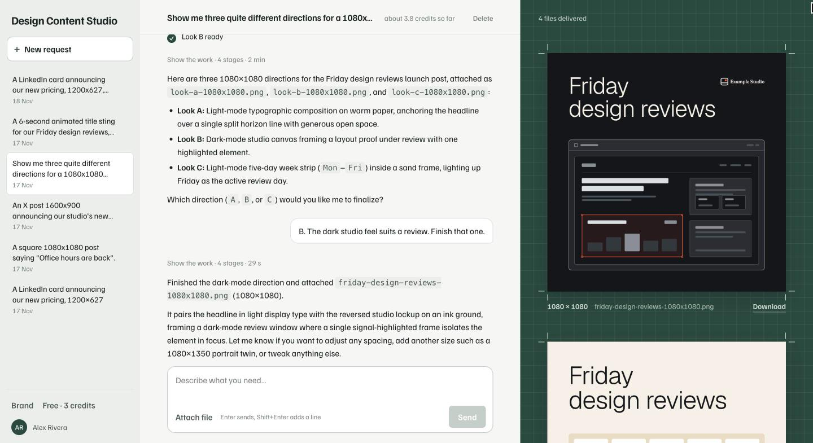
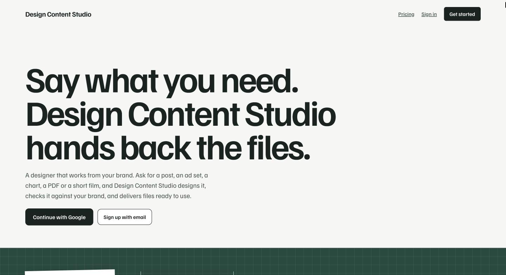
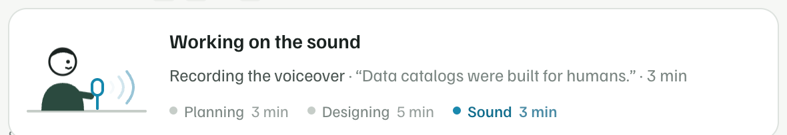
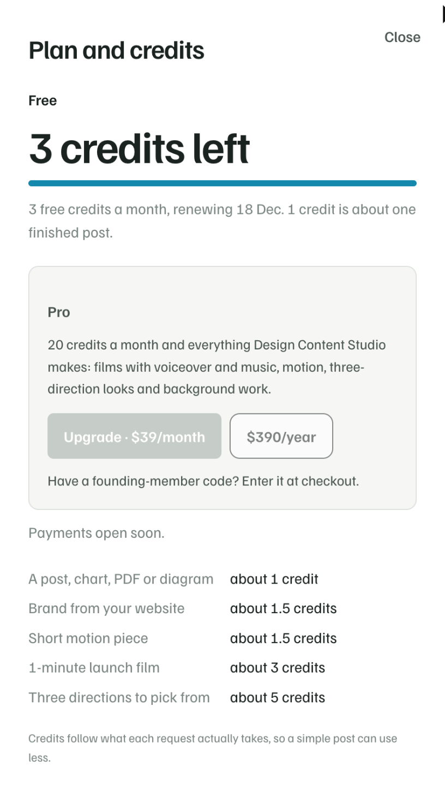
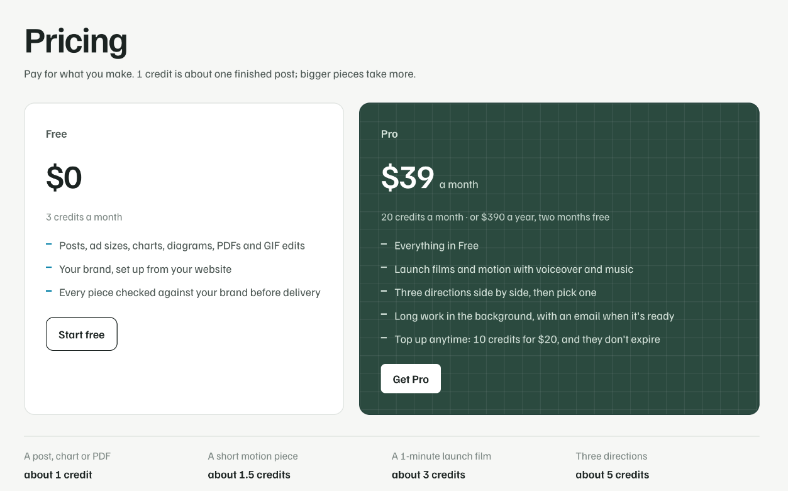
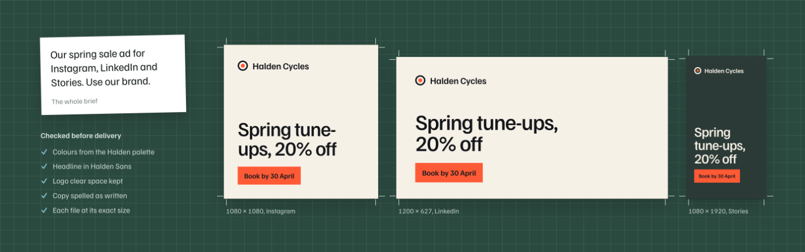
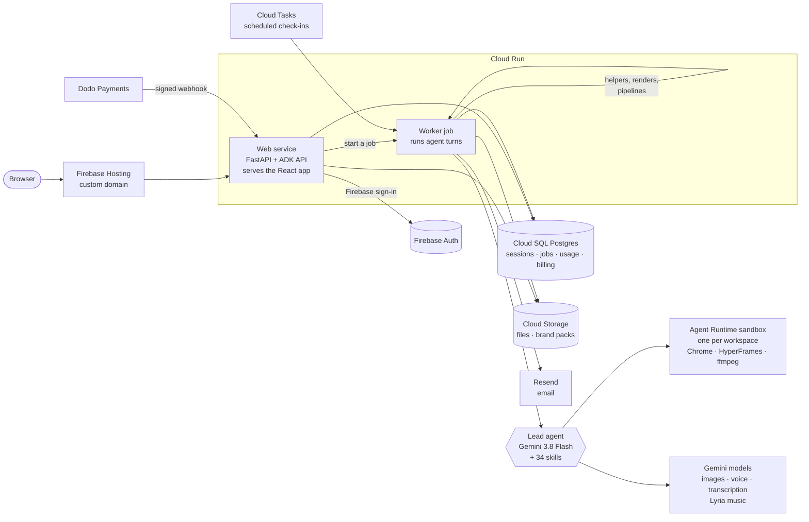

# Design Content Studio

**An AI designer that works from your brand.** Describe what you need in a sentence. It writes the brief,
designs the piece, checks it against your brand, and hands back finished files: social posts in every size,
ads, charts, diagrams, PDFs, GIFs, and short films with voiceover and music.

Built on [Google ADK](https://adk.dev) and Gemini. Inspired by LangChain's open-source
[design-agent](https://github.com/langchain-ai/design-agent) (see [Credits](#credits)).



## What it does

- **Stills.** Posts, banners, ad sets in every platform size, YouTube thumbnails, and restyling an image you attach.
- **Charts, diagrams and documents.** Bar and line charts, flow diagrams and one-page PDFs, all on-brand.
- **Motion and video.** Title stings and launch films up to a few minutes, with an AI voiceover and music. The
  agent shows a storyboard first and renders after you approve it.
- **Your brand, from your website.** Give it a URL. It captures your colours, type, logo and voice into a
  brand pack you review before it goes live.
- **Three directions, then pick.** Ask for options and helpers design them in parallel. Reply with a letter
  to finish one.
- **Checked before delivery.** Every file passes deterministic gates (brand colours and fonts, exact sizes,
  copy spelled as written, motion and audio checks) and the agent looks at its own render.
- **Works in the background.** Long jobs keep running after you close the tab. You get an email when they're ready.
- **Plans and credits.** Free and Pro plans, with credits based on what each request actually costs.
  Payments are optional (Dodo Payments).

| Landing page | Live progress |
| --- | --- |
|  |  |
| **Plans and credits** | **Pricing** |
|  |  |



## How a request flows

1. **You ask** in the web app. The server stores the message and starts a background job.
2. **The agent plans.** A Gemini agent reads your brand brief and loads the skills it needs (stills, motion,
   charts and more).
3. **It designs in a sandbox.** Each workspace gets its own sandbox with Chrome, HyperFrames, ffmpeg and sharp.
   The agent writes HTML or a motion composition there and renders it.
4. **It checks its work.** Gates verify brand, sizes, text and motion; the agent looks at the render and fixes
   what's off. Bigger jobs fan out to helpers that run in parallel.
5. **It delivers.** Files land on the proof wall with download links, the usage is metered into credits, and
   you get an email if you'd left.

## Architecture



| Piece | What it does | Code |
| --- | --- | --- |
| Web app | Vite + React. Workspace, proof wall, brand and plan panels, landing page | `web/` |
| Web service | ADK's FastAPI app plus Firebase auth, `/api` routes, billing webhook | `app/fast_api_app.py` |
| Worker | One Cloud Run Job execution per agent turn, helper, render watch or pipeline; retries resume the same ADK invocation | `app/worker.py`, `app/jobs.py`, `app/tasks.py` |
| Lead agent | ADK `LlmAgent` on Gemini with its instructions, skills and tools | `app/agent.py`, `app/prompt.md`, `app/skills/` |
| Sandbox | A container per workspace: renderers and gates run here, never on the server | `sandbox/`, `app/sandbox.py`, `app/sandbox_tools/` |
| Media | Image generation, voiceover, transcription, music | `app/tools.py`, `app/audio.py` |
| Background work | Helpers, parallel looks, render watchers, multi-step pipelines, check-ins | `app/helpers.py`, `app/looks.py`, `app/renders.py`, `app/pipelines/`, `app/wakeups.py` |
| Brand | Brand packs, brand-from-website capture and review | `app/brand/` |
| Metering and billing | Prices every model call; credits, plans, Dodo checkout and webhooks | `app/meter.py`, `app/billing.py` |
| Infrastructure | Terraform for everything above | `deployment/terraform/single-project/` |

## Run it locally

You need [uv](https://docs.astral.sh/uv/), Node 22, Docker, and a Google Cloud project with Vertex AI enabled
(the models run on Vertex; `gcloud auth application-default login` is enough locally).

```bash
# 1. The sandbox the agent designs in (and a second one, with network access, for brand-from-website)
docker build -t studio-sandbox:dev sandbox/
docker run -d -p 127.0.0.1:8080:8080 studio-sandbox:dev
docker run -d -p 127.0.0.1:8081:8080 studio-sandbox:dev

# 2. The API (sign-in is off locally; every request is user "dev")
cp .env.example .env            # set GOOGLE_CLOUD_PROJECT
uv sync
uv run uvicorn app.fast_api_app:app --port 8000

# 3. The web app
cd web && npm install && npm run dev    # http://localhost:5173
```

Tests and evals:

```bash
uv run pytest tests/unit                       # fast, no cloud
uv run pytest tests/integration                # needs the local sandbox
agents-cli eval run --dataset tests/eval/datasets/stills.json --config tests/eval/eval_config.yaml
```

## Deploy to Google Cloud

Everything is in Terraform under `deployment/terraform/single-project/`; `scripts/deploy.sh` ships the code.

1. **Settings.** Copy `vars/env.tfvars.example` to `vars/env.tfvars` and fill in your project, region and domain.
2. **Sandbox image and templates.** Build and push the sandbox image, then create the Agent Runtime sandbox
   templates; the script prints the two template names for your tfvars:
   ```bash
   docker buildx build --platform linux/amd64 -t REGION-docker.pkg.dev/PROJECT/studio/sandbox:v1 --push sandbox/
   uv run --no-project --with "google-cloud-aiplatform[agent-engines]" python scripts/sandbox_templates.py \
     --project PROJECT --location REGION --image REGION-docker.pkg.dev/PROJECT/studio/sandbox:v1
   ```
3. **Infrastructure.** `cd deployment/terraform/single-project && terraform init && terraform apply -var-file=vars/env.tfvars`
   creates Cloud SQL, Cloud Run, the worker job, Cloud Tasks, Storage, Firebase sign-in and Hosting.
4. **Code.** `PROJECT=your-project-id scripts/deploy.sh` builds one image for the web service and the worker.
5. **Domain.** `terraform output domain_dns_records` lists the DNS records to add at your registrar.
6. **Optional secrets** (Secret Manager, added from your own terminal):
   - `studio-resend-api-key` for "your files are ready" emails (see `docs/email-setup.md`)
   - `studio-dodo-api-key` and `studio-dodo-webhook-key` for payments; point the Dodo webhook at
     `https://YOUR_DOMAIN/api/billing/webhook` and put your product ids in `dodo_products`

## Configuration

| Setting | Where | Default |
| --- | --- | --- |
| Lead model | `lead_model` (Terraform) / `STUDIO_MODEL` | `gemini-3.8-flash` |
| Sign-in | `STUDIO_AUTH` | `off` locally, `firebase` deployed |
| Sandbox | `STUDIO_SANDBOX` | `docker` locally, `vertex` deployed |
| Plans and prices | `app/billing.py` (`ALLOWANCE`, `PRICING`, `CREDIT_USD`) | Free 3 credits, Pro 20 credits at $39/month |
| Model prices | `app/meter.py` | Gemini list prices |
| Always-Pro accounts | `owner_emails` (Terraform) | none |

## Project layout

```
app/                 the agent and server (Python, Google ADK)
  agent.py           lead agent: model, tools, callbacks
  skills/            the agent's workflows (SKILL.md)
  sandbox_tools/     renderers and gates that run inside the sandbox (Node)
  harness/           background-work and pipeline harness
web/                 the web app (Vite + React + TypeScript)
sandbox/             the sandbox image: runtime shim, Chrome, HyperFrames, ffmpeg, fonts, probe
deployment/          Terraform
scripts/             deploy and sandbox-template scripts
tests/               unit, integration and eval suites
docs/                setup notes and screenshots
```

## Credits

Inspired by LangChain's open-source [design-agent](https://github.com/langchain-ai/design-agent), and
includes Apache-2.0 components from it (agent skills, rendering checks and parts of the harness), with
changes noted in each file. It also builds on [HyperFrames](https://github.com/heygen-com/hyperframes) and
the Google ADK samples. [NOTICE.md](NOTICE.md) lists every component and its license.

Design Content Studio is an independent project, not affiliated with or endorsed by LangChain, Inc.

## License

[Apache-2.0](LICENSE). Third-party components keep their own licenses; see [NOTICE.md](NOTICE.md) and `licenses/`.
